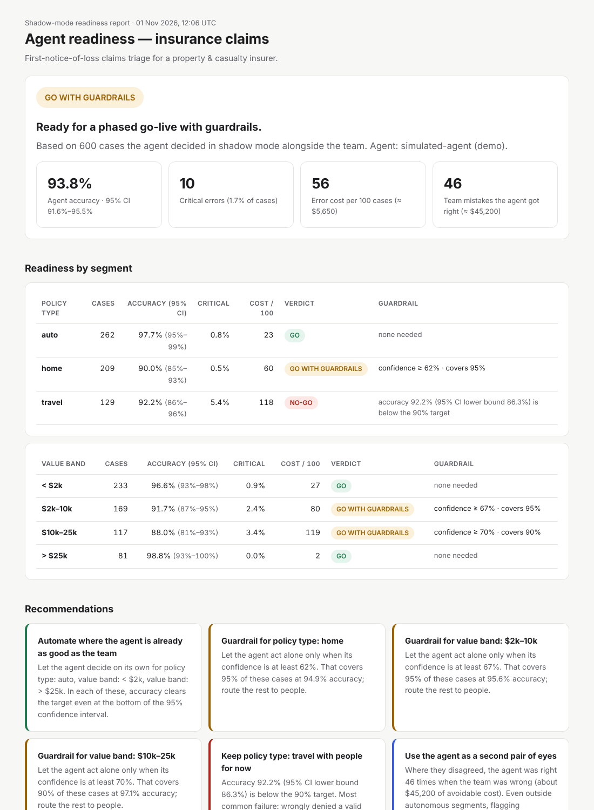
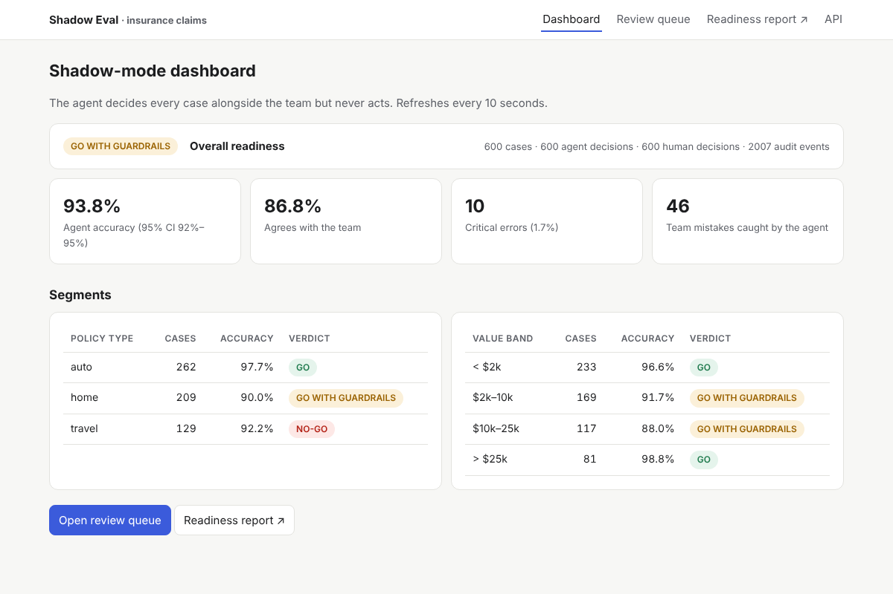
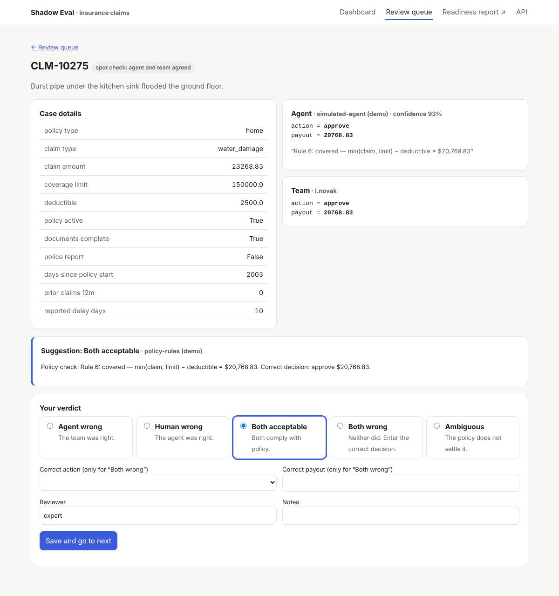

# Shadow Eval

**Is your AI agent ready to go live? Run it in shadow mode next to your team and get a verdict your business can act on.**

Most enterprise AI agents never leave the pilot stage. When it is time to let one act on real customers, the
Head of Operations, Compliance and Risk all ask the same question: *"How do we know it decides as well as our
people do?"* An accuracy number on a hand-picked test set does not answer it.

Shadow Eval does. The agent sees the **same real cases** as your team and records what it *would* do, without
ever acting. Shadow Eval then:

1. compares every agent decision with the human one, allowing small numeric differences,
2. weights each disagreement by what that mistake would **cost the business**,
3. works out **who was right**: an AI adjudicator suggests, a subject-matter expert confirms,
4. scores each segment with **confidence intervals**, and finds **confidence-threshold guardrails**,
5. writes a **go-live readiness report**: *GO*, *GO WITH GUARDRAILS* or *NO-GO*, segment by segment.

It works with **any model**: open-source models running locally through **Ollama** (free), open models on
**Hugging Face**, **Claude**, or your own agent. The full demo runs offline, free, with no API key.



## Why this exists

| Common practice | What goes wrong | What Shadow Eval does |
|---|---|---|
| Evaluate on a synthetic test set | Misses the messy real distribution | Runs on real cases, from historical data or live traffic |
| Exact-match scoring | "$1,180 vs $1,200" counts as wrong | Matching with tolerances, field by field |
| Every error counts the same | Wrongly denying a valid claim ≠ an extra escalation | A business cost table, with critical errors flagged |
| Assume the human is right | Sometimes the agent is right | Blind adjudication; reports team mistakes the agent caught |
| Agreement = correct | Agent and human can share the same mistake | Spot-checks a sample of agreements and bounds shared mistakes |
| One accuracy number | Executives need a decision | A verdict for each segment, guardrails and a rollout plan |

Shadow mode with comparison against human decisions exists inside proprietary platforms (e.g. Dynamics 365).
Open-source tools can record what an agent did, but they don't compare it with what humans decided, adjudicate,
or give a readiness verdict. Shadow Eval fills that gap.

## Quick start (free, offline)

```bash
git clone https://github.com/Aravindhant07/shadow-eval && cd shadow-eval
pip install -e .
shadow demo --serve
```

Open <http://127.0.0.1:8000>. The demo builds 600 synthetic insurance claims, runs a simulated agent in
shadow mode, has a simulated expert settle the most costly disagreements, and leaves the rest in the review queue.

| Dashboard | Expert review |
|---|---|
|  |  |

## Use a real model

### Open-source models, locally and free (Ollama)

```bash
# install Ollama from https://ollama.com, then:
ollama pull qwen2.5:7b
shadow run --agent ollama --model qwen2.5:7b \
  --cases data/demo/cases.json --human data/demo/human.csv --db claims.db
shadow suggest --adjudicator ollama --db claims.db      # AI suggests who was right
shadow serve --db claims.db                             # expert reviews in the browser
shadow report --db claims.db -o readiness_report.html
```

Any Ollama model works (Llama, Mistral, Gemma, Phi …). Decisions are constrained to a JSON schema generated
from your domain config, so they always parse.

### Open models on Hugging Face

```bash
export HF_TOKEN=hf_...   # free token: huggingface.co/settings/tokens
shadow run --agent hf --model Qwen/Qwen2.5-72B-Instruct --db claims.db --limit 50
```

Free Hugging Face accounts include a small monthly credit for Inference Providers. Use `--limit` to stay inside it.

### Open models from Hugging Face, run locally (free, no API)

```bash
pip install -e ".[local]"      # torch + transformers; CPU is fine for small models
shadow run --agent local --model Qwen/Qwen2.5-1.5B-Instruct --db claims.db --limit 20
```

### Claude (optional)

```bash
pip install -e ".[claude]"
export ANTHROPIC_API_KEY=...
shadow run --agent claude --db claims.db      # uses the model and effort set in the domain YAML
```

The run log records tokens and cost for each case, and the report shows the total cost of the evaluation.

### Your own agent

Anything with a `name` and a `decide(case) -> AgentResult` method:

```python
from shadow_eval.agents import AgentResult
from shadow_eval.models import Decision

class MyAgent:
    name = "my-agent-v3"
    def decide(self, case):
        action, payout, conf = my_existing_pipeline(case)
        return AgentResult(Decision(values={"action": action, "payout": payout}, confidence=conf))
```

## Live shadow mode

Wrap your production function. Its behaviour and return value never change; the agent runs in the background,
and agent failures never reach production.

```python
from shadow_eval.capture.live import ShadowObserver

observer = ShadowObserver(store, domain, agent)

@observer.observe
def triage_claim(claim):          # your existing code, unchanged
    return route_to_adjuster(claim)

# hours later, when the adjuster decides:
observer.record_human("CLM-10042", {"action": "approve", "payout": 1180}, decided_by="j.okafor")
```

Or over HTTP. `shadow serve --agent ollama` exposes:

| Endpoint | Purpose |
|---|---|
| `POST /api/cases` | Record a case; the agent decides it in the background |
| `POST /api/human-decisions/{case_id}` | Join the human decision later |
| `GET /api/metrics` | Readiness and segment metrics as JSON |
| `GET /api/audit/verify` | Check the tamper-evident audit log |

See [`examples/live_capture.py`](examples/live_capture.py).

## Any domain, one YAML file

Everything domain-specific lives in a config file. Here is part of
[`domains/insurance_claims.yaml`](domains/insurance_claims.yaml):

```yaml
decision:
  - {name: action, type: enum, values: [approve, deny, request_info, escalate, flag_fraud]}
  - {name: payout, type: number, match: tolerance, tolerance_pct: 0.05, tolerance_abs: 50}
primary_field: action

cost_matrix:                         # cost of the agent saying X when Y was right
  - {agent: approve, truth: flag_fraud, cost: 25, critical: true, label: "Paid a suspected fraudulent claim"}
  - {agent: deny,    truth: approve,    cost: 20, critical: true, label: "Wrongly denied a valid claim"}
  - {agent: escalate, truth: "*",       cost: 1,  label: "Unnecessary escalation"}

segments:
  - {name: policy_type, field: policy_type}
  - {name: value_band, field: claim_amount, bins: [2000, 10000, 25000], labels: ["< $2k", "$2k–10k", "$10k–25k", "> $25k"]}

readiness:
  min_accuracy: 0.90        # applied to the lower bound of the 95% confidence interval
  max_critical_rate: 0.02
  spot_check_rate: 0.05     # share of agreements sent to experts
```

Loan underwriting, KYC review, support-ticket routing, medical coding: write a new YAML file. No code changes.

## How the verdict is reached

- **Correct answer.** When agent and team agree, their shared decision. When they disagree, the expert's verdict:
  *agent wrong*, *team wrong*, *both acceptable*, *both wrong* (with the correct decision) or *ambiguous*.
  Unreviewed disagreements assume the team was right, and the report is marked **provisional**.
- **Blind adjudication.** The LLM adjudicator sees the two decisions as "A" and "B" in a random order and is
  never told which came from the agent.
- **Statistics.** Accuracy uses the Wilson score interval. A segment is **GO** only if the **lower bound**
  clears the target, so small samples cannot fake readiness.
- **Guardrails.** For segments that miss the gate, Shadow Eval looks for the lowest confidence threshold at which
  the cases the agent would handle alone pass every gate while still covering enough volume.
- **Shared mistakes.** A deterministic sample of agreements goes to experts. The report gives an upper bound on
  how often agent and team share a mistake.
- **Audit trail.** Every case, decision and review is appended to a SHA-256 hash chain.
  `shadow verify-audit` detects any edit or deletion.

## Results on the synthetic benchmark

The repository includes a synthetic insurance-claims benchmark (`shadow generate`). It has known ground truth
and 49 deliberately seeded human mistakes. The agent in this benchmark is **simulated**: a stand-in with
realistic weak spots, used so the pipeline can be measured for free.

| Check | Result |
|---|---|
| Seeded human mistakes found | 46 / 49 (94%), 0 false accusations |
| Agent mistakes found | ≥ 90% (tested) |
| Missed mistakes | 3: cases where agent and human made the **same** mistake. This is why spot checks exist |
| Verdict | GO for auto claims, guardrails for home claims, NO-GO for travel claims (confidently wrong denials of medical claims abroad) |
| Audit chain | intact; tampering is detected in tests |

Run `pytest` to reproduce these checks: 30 tests, offline.

## Real open-model results

The numbers above measure a *simulated* agent. To test Shadow Eval on a real model, I downloaded an
open-source model from Hugging Face and ran it **locally on CPU** (`--agent local`, free, no API) in
shadow mode on 20 demo claims, a stratified sample across auto, home and travel.

| Model | Accuracy (95% CI) | Critical errors | Failed to answer | Avg confidence | Verdict |
|---|---|---|---|---|---|
| Qwen2.5-1.5B-Instruct | 21% (9%–43%) | 7 of 19 | 1 | ~0.95 | INSUFFICIENT DATA (n < 30), clearly not ready |

What Shadow Eval caught:

- **Paid what should never be paid.** On a $252 windshield claim below the $500 deductible (correct:
  deny), the model approved **$20,197**. Its stated reasoning was about escalating to a senior adjuster,
  which contradicts its own decision.
- **Missed fraud signals.** On a theft claim with no police report, reported 112 days late (correct:
  flag for fraud), it approved $12,836.
- **Arithmetic errors.** It often forgot the deductible, so payouts were off by more than the tolerance.
- **Broken output.** One answer put arithmetic inside the JSON (`"payout": 12723.76 - 250 = ...`).
  Shadow Eval records that as a failure, not a crash.
- **Confidence is useless here.** The model reported about 95% confidence on almost everything, right
  or wrong, so no confidence-threshold guardrail can rescue it.

Per-claim results: [`docs/results/`](docs/results/). Reproduce with:

```bash
pip install -e ".[local]"
python scripts/real_model_run.py --model Qwen/Qwen2.5-1.5B-Instruct --n 20
```

## Project layout

```
shadow_eval/
  config.py         domain YAML → validated config
  llm.py            Claude · Ollama · Hugging Face JSON backends
  agents/           agent interface, LLM agent
  capture/          batch replay, live observer
  compare.py        matching with tolerances, error cost
  adjudicate.py     blind LLM adjudicator, review queue, spot checks
  score.py          segment metrics, Wilson CIs, guardrails, verdicts
  report.py         executive HTML report
  store.py audit.py SQLite + hash-chained audit log
  web/              FastAPI review UI, dashboard, REST API
  demo/             synthetic claims generator, simulated agent and expert
domains/            insurance_claims.yaml + policy
docs/               PROBLEM.md · REQUIREMENTS.md · DESIGN.md
```

## Limitations

- The bundled benchmark uses a simulated agent and a simulated expert. Real results depend on your model and data.
- Agent confidence is self-reported. Check the calibration table in the report before relying on a guardrail.
- The web UI has no authentication; run it inside your network.

## Deploy the demo

- **Gradio Space**: `app.py` serves the web app plus an interactive "try a claim" page at `/try`
  (see [`deploy/huggingface/README.md`](deploy/huggingface/README.md)). Run it locally with
  `pip install gradio && python app.py`.
- **Static site (free anywhere)**: `shadow export-static --demo --out site` writes a landing page with
  results, a JavaScript "try a claim" widget and the full report. Host it on GitHub Pages or a free
  Hugging Face Static Space.
- **Docker**: the `Dockerfile` is there for self-hosting.

## License

MIT
